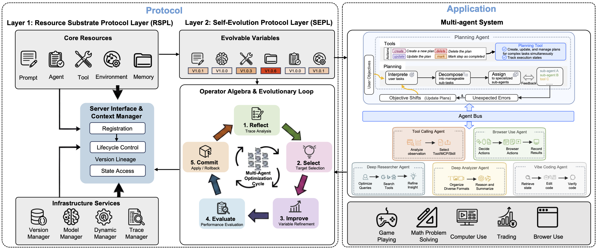

# AGP 学习笔记：把“自进化 Agent”做成一套可控协议

## 一、我现在对 AGP 的整体理解

AGP（Autogenesis Protocol）的真正价值，不在于“又做了一个 agent 框架”，而在于它试图回答一个更本质的问题：

**如果我们希望一个 agent 系统持续变强，那么它到底应该进化什么，以及应该如何安全地进化？**

传统 agent 系统一般更关注“如何完成当前任务”，但对“如何在多次执行后持续优化自己”考虑得不够系统。很多系统即便看起来能反思、能重试，本质上也只是一次性推理流程更复杂，并没有真正把“进化对象”“进化流程”“版本谱系”“回滚机制”独立设计出来。

AGP 的关键贡献，就是把这个问题拆成两层：

- **RSPL**：定义“什么可以被进化”
- **SEPL**：定义“这些东西应该怎么被进化”

这个拆分非常重要，因为它把“能力提升”从一种模糊的模型玄学，变成了一套清晰的工程对象和控制流程。

---

## 二、RSPL：先定义清楚“进化对象”

RSPL（Resource Substrate Protocol Layer）可以理解为“资源基底协议层”。

这里最重要的思想是：

**一个 agent 系统里，不是只有模型在工作，真正决定系统行为的是一整套资源集合。**

这些资源包括但不限于：
- prompt
- agent 逻辑
- tool
- environment
- memory

如果没有这层视角，我们很容易把 agent 的表现简单归因于“模型强不强”。但实际上，很多能力并不是模型参数直接决定的，而是由以下这些东西共同塑造的：

- prompt 如何约束推理过程
- tool 能不能提供有效外部能力
- environment 能不能提供结构化反馈
- memory 能不能沉淀经验
- agent 本身如何规划、调用、复盘

所以 RSPL 的本质是：

**把 agent 系统中的关键构件都看作“资源”，并要求这些资源具备统一的协议属性。**

这些协议属性通常包括：
- 可注册
- 可引用
- 有状态
- 有生命周期
- 可版本化
- 可恢复
- 可比较

这意味着资源不再只是散落在代码里的静态实现，而是系统内部的“一级对象”。

### 为什么这件事重要？

因为只有当一个对象被明确建模为资源，它才真正具备“可进化性”。

换句话说：

**能否进化，不取决于你有没有写 optimizer，而取决于你有没有先把系统拆成可被操作、可被替换、可被追踪的资源。**

这就是我现在最认可 AGP 的地方。它不是先问“怎么优化”，而是先问“你到底在优化谁”。

---

## 三、我现在对“资源”的理解

我觉得“资源”不能泛化成“系统里发生的一切”，那样虽然听起来很大，但没有工程意义。

更准确的理解应该是：

**资源是那些能够被系统显式引用、管理、更新、回滚、比较，并且会持续影响系统行为的核心对象。**

而执行过程中的很多东西，比如：
- 某次任务输出
- 中间轨迹
- 某次失败记录
- 某条观察结果

它们更适合被理解为：
- 资源运行后的状态
- 资源演化的证据
- 后续优化的输入材料

所以我现在会这样区分：

- `prompt / tool / memory / environment / agent` 是资源
- `trace / result / event / feedback` 是资源进化的依据

这个 distinction 很重要。

因为如果没有“资源对象”和“演化证据”的区分，自进化系统就会变成一锅粥：你既不知道该改什么，也不知道为什么改，更不知道改完以后和原来相比发生了什么。

---

## 四、SEPL：真正回答“怎么进化”

如果说 RSPL 回答的是“what evolves”，那么 SEPL（Self-Evolution Protocol Layer）回答的就是“how to evolve”。

SEPL 的思想，不是简单地“发现错了就改一改”，而是把进化做成一个**闭环控制过程**。

核心逻辑可以概括为：

1. 观察当前系统表现
2. 分析问题出在哪里
3. 选择应该更新的目标资源
4. 生成新的资源版本
5. 评估新版本是否更好
6. 决定保留、继续优化，还是回滚

这个闭环最重要的不是“优化”两个字，而是“闭环”和“控制”。

因为没有控制的进化，本质上只是漂移。

### SEPL 不是让系统瞎改自己

我觉得很多人一说“自进化 agent”，脑子里容易浮现一种浪漫但危险的想象：

- agent 自己写自己
- agent 自己改自己
- agent 会越来越强

但如果没有 SEPL 这种控制层，这种系统大概率不是越来越强，而是越来越不可预测。

SEPL 的价值就在于：

**它不是鼓励自由漂移，而是要求进化必须经过一个可解释、可审计、可回滚的流程。**

这件事和传统软件工程其实非常一致。

软件里我们不会让线上系统直接无约束改代码；
同样地，agent 系统也不应该无约束修改自己的核心资源。

---

## 五、SEPL 到底在进化什么？

从思想上讲，SEPL 进化的不是“模型参数本身”，而是**那些支配系统行为的资源变量**。

也就是说，它的关注点不是：
- 模型内部某一层权重怎么调

而是：
- prompt 是否应该重写
- tool 是否应该增强或修复
- agent 的行为规则是否应该调整
- memory 的组织方式是否应该优化
- environment 的反馈接口是否应该更合理

所以它更像一种：

**系统级进化，而不是参数级训练。**

这也是我觉得它很有启发性的地方。

因为在真正的 agent 工程里，很多问题根本不是靠 finetune 模型就能解决的，反而更常见的是：
- prompt 约束不合理
- tool abstraction 太弱
- memory 没有形成有效经验
- planning/verification 流程有缺口

AGP 其实是把这些“系统级缺陷”正式拉进了优化空间。

---

## 六、版本管理为什么是这套思路的灵魂

我觉得 AGP 最有工程含金量的点之一，就是它特别强调**版本管理**。

这是因为“进化”一旦发生，系统就不再是一个静态对象，而是一个不断演化的对象序列。

既然如此，就必须回答这些问题：

- 当前系统到底是哪一版？
- 这版和上一版差在哪？
- 哪个资源被改了？
- 为什么改？
- 改完以后效果有没有提升？
- 如果变差了，能不能撤回？

如果这些问题没有答案，那么所谓“自进化”其实只是一次又一次的覆盖写入，最后谁也不知道系统为什么变成今天这样。

所以版本管理不是附属功能，而是 AGP 里“可控进化”成立的前提。

我现在会把它理解为三层价值：

### 1. 可追溯
你可以知道每次进化到底改了什么。

### 2. 可比较
你可以比较不同资源版本对系统表现的影响。

### 3. 可回滚
你不会因为一次错误优化把整个系统拖入不可恢复状态。

这实际上把 agent 系统从“黑盒行为体”往“可维护的软件系统”方向推了一大步。

---

## 七、AGP 和普通 agent framework 的本质区别

我觉得可以这么概括：

### 普通 agent framework 更关心：
- 任务如何执行
- 工具如何调用
- 多智能体如何协作
- 工作流如何编排

### AGP 更进一步关心：
- 哪些东西是系统的可进化资源
- 这些资源如何被显式建模
- 资源变更如何形成版本谱系
- 系统如何在闭环中持续优化自己

也就是说，普通 framework 更像“运行时框架”，而 AGP 更像是在运行时框架之上又加了一层：

**进化控制协议。**

这个角度非常重要。

因为它说明 AGP 的目标不是替代所有 agent framework，而是试图给 agent 系统补上一套长期演化所缺失的制度层。

---

## 八、我觉得这套思路最值得记住的地方

### 1. 先定义进化对象，再谈进化算法
很多系统一上来讨论“优化器怎么设计”，但 AGP 先问“哪些对象应该进入优化空间”。

这一步非常对。

### 2. 进化不是模型专属能力，而是系统能力
真正的 agent 变强，很多时候依赖的是 prompt、tool、memory、workflow、verification，而不是单纯依赖权重更新。

### 3. 自进化一定要版本化
没有版本、谱系、恢复能力，自进化最后一定会走向不可维护。

### 4. 闭环比单次优化更重要
一次性优化没那么关键，关键是形成“观察 -> 分析 -> 更新 -> 评估 -> 保留/回滚”的长期机制。

### 5. 这套思路特别像“给 agent 引入软件工程纪律”
我觉得这是 AGP 最打动我的地方。

它并不是神神叨叨地谈 AI 如何自我成长，而是在认真地问：

**如果一个 agent 系统真的要持续成长，我们该如何像管理软件系统一样管理它的成长？**

---

## 九、我自己的总结

我现在会把 AGP 理解成一句话：

**AGP 不是在讨论“怎么把模型做得更聪明”，而是在讨论“怎么把一个 agent 系统变成可持续演化、可追踪、可回滚、可治理的工程系统”。**

其中：
- `RSPL` 解决的是“把什么纳入进化空间”
- `SEPL` 解决的是“如何以可控方式进行进化”
- `Versioning` 解决的是“如何让进化不是一次性改写，而是一条可审计的演化谱系”

我觉得这套划分非常有意义。

因为它提供的不是一个具体技巧，而是一种更高层的 agent 工程视角：

**未来真正强大的 agent 系统，未必是单次推理最强的系统，而更可能是那些能安全、自主、长期优化自身资源结构的系统。**
