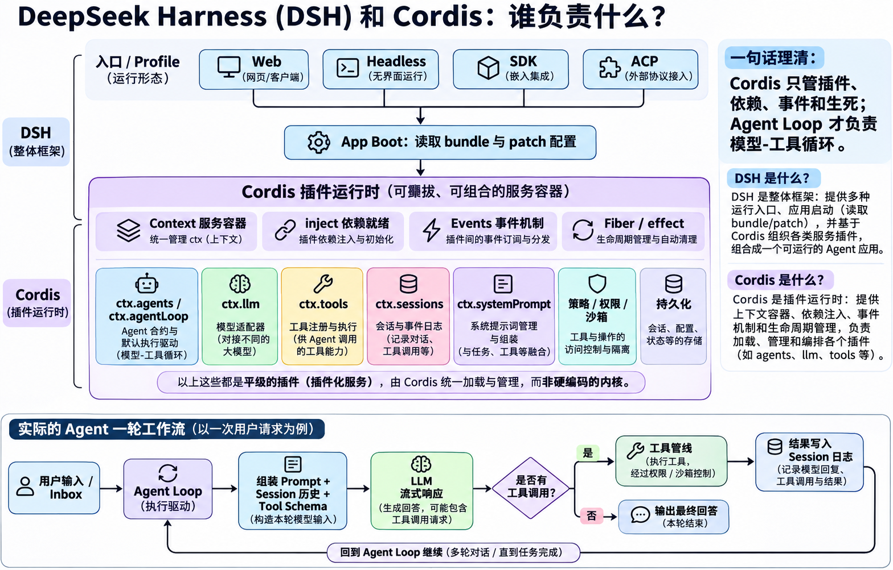

# DeepSeek Harness 拆解总览

> 状态：已建立研究地图，基础概念见 [[00_cordis_and_tool_basics]]，Profile/Bundle/Preset 职责与装配关系见 [[00_profile_bundle_preset]]；其余组件仍按索引推进。本文中的主链预读不代表各组件已经研究完成。
>
> 首次建立地图：2026-10-26；仓库：`/Users/zhouchenghao/orca/deepseek-harness`。当前阅读基线：`master` / `ce7073d512`，2026-11-03 核对；初始地图基线为 `22ddee3792`。后续讲解以当时源码为准，未展开的组件仍需逐项重新核对。
>
> 总规则：[[all_harness/00_拆解共识]]；阅读进度：[[01_components]]。

## 框架总览图

用户提供的 DSH 与 Cordis 分工图，2026-11-03 保存。上半部分说明框架组成，下半部分说明默认循环的常见运行路径。



阅读口径：

- 图中“平级插件”表示这些组件均通过 Cordis 插件机制提供，不表示它们没有依赖关系。Cordis 管理插件运行，默认 Agent Loop 插件推进模型与工具循环。
- 普通文本回答也会写入会话日志；用户输入、系统提示、请求配置等模型请求重建所需的信息同样有相应记录，不只有工具分支才记录。
- “没有工具调用 → 本轮结束”是常见路径的简化表示；实际还需检查待处理输入和停止前扩展工作。Session 内存追加与持久化落盘也由不同步骤负责。

## 1. 我们要研究什么

沿一个具体任务，弄清楚 DSH 怎样接收输入、准备模型请求、调用工具、保存状态，并决定继续、等待、取消或结束。最终提炼可与 Pi、Hermes 比较的 Harness 设计，不按仓库目录介绍全部产品功能。

初步主线采用 headless 单次任务入口，因为它直接创建或恢复 Agent，便于追踪运行链。Web、Desktop、SDK、ACP 中影响 Agent 行为的输入处理、会话选择、控制和输出随后分别核对，不能由 headless 的结论直接代替。

示例任务：用户要求“读取项目说明，找出启动方式”。模型可以先调用文件工具，拿到内容后继续回答。后续各组件优先沿这个例子说明输入、动作、输出和状态变化。

## 2. 首先要理解的 DSH 特点

### 2.1 运行能力由插件组合出来

源码确认：模型适配、工具注册、提示组装、会话和默认执行循环分别由插件提供。启动配置决定装入哪些插件；插件通过共享的 Cordis Context 获取服务、注册事件和贡献能力。

初步理解 Cordis 只需要抓住三件事：服务提供可调用的能力，事件提供观察或干预运行的时机，可释放的注册决定插件卸载时怎样收回贡献。依赖如何激活、作用范围如何隔离、卸载顺序如何保证，仍需专门共同阅读。

源码入口：`packages/bundle/base/cordis.patch.yml`、`packages/core/agent-loop/src/index.ts`、`packages/core/tools/src/index.ts`。架构说明入口：`docs/architecture.md`、`docs/cordis-primer.md`。

### 2.2 会话日志参与生成模型历史

源码确认：循环先把接纳的模型可见输入记入 Session，再调用 `deriveMessages()` 生成当前请求的消息。并非所有事件都变成聊天消息；当前生效的消息节点由 Session 的 surface 管理，压缩等操作可以替换其中一段。

因此必须分开研究：完整事件日志、当前模型历史、当前进程的 Agent 状态、落盘记录和 UI 展示。向内存 Session 追加事件，也不能直接等同于已经完成磁盘持久化。

源码入口：`packages/core/agent-loop/src/agent.ts` 的 `step()` / `buildRequest()`、`packages/core/session/src/index.ts` 的 `deriveMessages()`、`packages/core/session/src/surface.ts`。

### 2.3 工具能力和模型调用工具的方式分开

源码确认：工具注册表保存能力定义；执行器决定这些能力怎样呈现给模型、怎样执行。原生执行器直接提供各工具的 schema；PTC 执行器直接暴露 `run_code`，并提供工具 SDK 说明，使模型能在程序中调用底层能力。二者使用共享的工具执行管线。

共享 base 配置启用原生执行器，并将 PTC 执行器设为禁用；其他 profile、preset 和 patch 的实际选择要分别核对。不能把仓库支持某种能力写成所有会话默认启用。

源码入口：`packages/core/tool-executor-native/src/index.ts`、`packages/core/tool-executor-ptc/src/index.ts`、`packages/core/tools/src/pipeline.ts`、`packages/bundle/base/cordis.patch.yml`。

## 3. 一条已经追到的主运行链

```text
用户提交 headless 任务
  |
  v
dsh CLI 选择 profile，组合配置并启动插件
  |
  v
headless runner 等待插件加载完成
  |-- 新任务：创建 Agent 和 Session
  `-- 指定已有会话：检查并恢复 Session
  |
  v
将用户消息放入下一 turn 的队列，并唤醒 Agent
  |
  v
开始 turn，领取消息
  |
  v
固定本 step 的模型选择，确定可用工具，组装提示和运行上下文
  |
  v
运行请求前的扩展逻辑：接纳、改写或拒绝本步输入
  |
  v
开始 step，准备模型调用
  |
  v
记录接纳的提示和消息、请求配置及必要的上下文信息
  |
  v
从 Session 生成并冻结模型请求，调用已绑定的适配器
  |
  v
接收流式响应，记录完整回答或本次失败尝试
  |-- 文本结束：检查是否还有本步之后要处理的输入或停止前工作
  |-- 工具调用：执行工具，记录调用和结果，再进入后续 step
  `-- 可恢复失败：由扩展点决定是否重试当前 step 的模型请求
  |
  v
结束 turn；队列仍有任务时继续，否则进入空闲
  |
  v
headless runner 等待相关子任务收束，flush Session，输出结果并请求退出
```

这是默认循环的主干。空输入、拒绝、取消、长度上限、工具结束请求、失败恢复和退出期间的新输入仍需逐项讲解；图中出现的“结束”不能理解为任何文本响应都会立即让进程退出。

DSH 中一个 step 包含一次模型请求及其工具处理，失败重试可能产生多次物理模型请求；一个 turn 可以包含多个 step。Pi 笔记对 turn 的用法不同，跨项目比较时要先对齐含义。

## 4. Agent-centric 架构图

```text
运行入口：headless / Web / Desktop / SDK / ACP
                         |
              profile、bundle、patch
              决定本次加载的插件组合
                         |
                         v
              创建 / 恢复 Agent 和 Session
              安装该 Agent 范围内的能力
                         |
                         v
              输入队列和默认 Agent 循环
              领取消息 -> turn -> step
                         |
           +-------------+---------------+
           |                             |
           v                             v
    提示与上下文组装                可用工具选择
    指令、提示段、动态事实           注册、限制、条件、执行器
           |                             |
           +-------------+---------------+
                         |
                         v
          接纳输入并记录到 Session，生成请求
                         |
                         v
                模型适配与流式响应
                 |               |
             最终文本          工具调用
                 |               |
                 |        校验、策略、审批、执行
                 |               |
                 |          记录工具结果
                 |               |
                 |           回到下一 step
                 v
          停止前检查 -> turn 结束或继续

横切能力：
  取消、重试、压缩、超时、审批、子 Agent、目标续跑、扩展

记录与输出：
  Session 事件日志 -> 当前模型历史 / 各类状态投影
                  -> 持久化与恢复 / 会话查询
  实时响应事件    -> 当前输出界面的流式展示
```

## 5. 研究边界

纳入所有会改变模型看到什么、能调用什么、状态怎样变化或任务是否继续的代码：入口与生命周期、队列、循环、提示、指令、模型适配、工具、PTC、持久化、恢复、压缩、权限、子 Agent、事件、技能、MCP、动态插件、preset、目标、工作流和调度。

文件系统、Shell、子进程、终端、沙箱、附件和大结果外溢也要纳入其影响工具行为和模型输入的部分。前端只研究输入控制、模型结果呈现、交付和运行状态相关逻辑；普通布局、计费、安装发布和无关工程实现不作为主线。

以下内容仍待核实，不能先下结论：

- 每个 profile 和 preset 的最终提示、工具与控制策略；当前只沿 headless 和共享 base 追踪。
- Web、SDK、ACP、Desktop 如何创建、恢复和控制会话；入口差异是否改变模型行为。
- 是否存在独立的长期记忆读写链；不能把 Session、会话搜索、技能或压缩直接当作长期记忆。
- 实验性 Agent Teams、Webhook、浏览器和计算机能力怎样接入；按实际插件组合确认，不能默认视为基础路径。

## 6. 初始源码锚点

以下路径均相对于仓库根目录；函数名用于定位，不代替行为说明。

| 主线 | 源码入口 | 本轮预读范围 |
| --- | --- | --- |
| 启动 | `apps/cli/src/bin.ts`、`apps/cli/src/profile-boot.ts` | CLI 分派、profile 组合入口 |
| 默认插件组合 | `packages/bundle/base/cordis.patch.yml`、`packages/bundle/headless/cordis.patch.yml` | 共享能力、headless 覆盖项 |
| 单任务入口 | `packages/bundle/headless/src/index.ts` 的 `run()` | 创建与恢复、提交消息、等待、flush、结果输出 |
| Agent 创建与恢复 | `packages/core/agent-loop/src/index.ts` 的 `initializeAgent()` / `createAgent()` / `resume()` | 创建发布入口、恢复日志、退出资源顺序 |
| 默认循环 | `packages/core/agent-loop/src/agent.ts` | 输入、turn、step、请求、响应、工具和停止条件 |
| 提示 | `packages/core/system-prompt/src/index.ts` | section、context、变量、工具声明的组装 |
| 工具 | `packages/core/tools/src/index.ts`、`pipeline.ts`、`batch.ts` | 注册、作用范围、执行管线与批处理入口 |
| 调用方式 | `packages/core/tool-executor-native/src/index.ts`、`packages/core/tool-executor-ptc/src/index.ts` | 工具声明与执行器分工 |
| 模型 | `packages/llm/llm/src/index.ts` 的 `prepareCall()` | 准备并绑定适配器、冻结配置、单次发送 |
| 模型历史 | `packages/core/session/src/index.ts` 的 `deriveMessages()` | 从当前生效的消息节点生成历史 |
| 恢复与可靠性 | `packages/compaction/compaction-basic/src/index.ts`、`packages/llm/llm-retry/src/index.ts` | 压缩和重试的扩展点入口 |

Cordis 与工具基础的已确认范围见 [[00_cordis_and_tool_basics]]。其他组件的进度详见组件索引；源码预读不是共同阅读，也不是行为完整性审核。

## 7. 后续共同阅读方式

先用具体任务讲运行行为，再看组件分工，最后给出代码锚点。每个组件先建立完整操作清单，区分默认流程、条件分支、后台工作、状态写入、失败与取消；发现新操作时补入索引并说明。

建议从“插件怎样连接能力”的最小前置知识开始，然后读 Agent Loop、状态与生命周期、上下文、工具、Session；再展开其余组件。详细笔记只在对应内容讨论并确认后写入，当前不预填所有章节。
