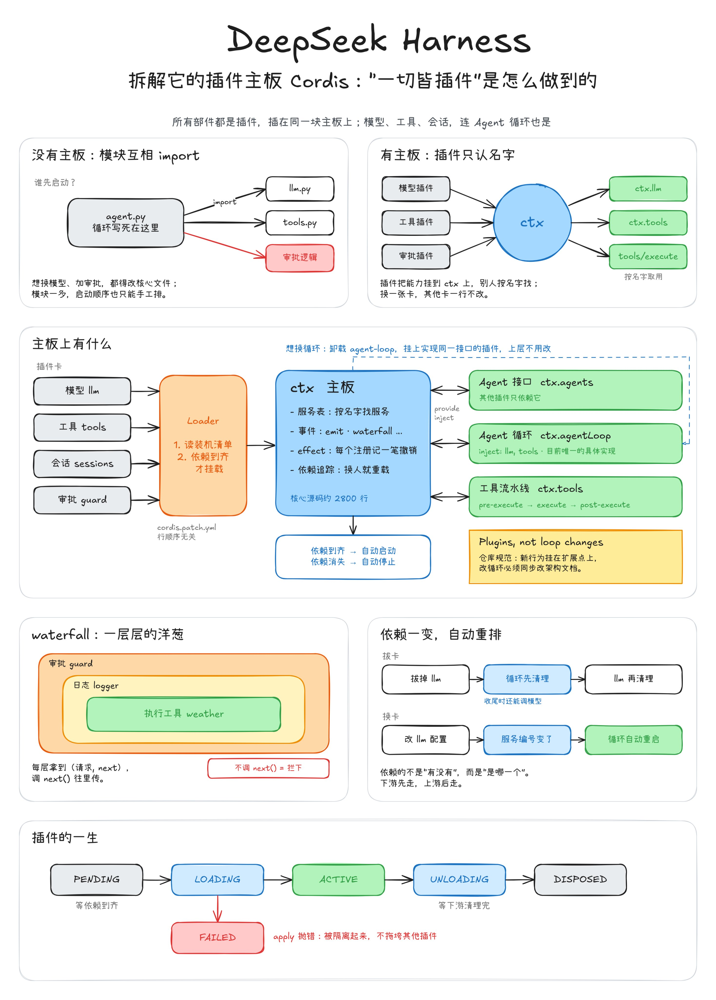

# 02 运行装配与插件架构

> 状态：02.1—02.2 的限定概念与边界已确认；02.3 已讲解、理解未确认；02.4 服务实例设计与 02.5 带范围的钩子／中间件已理解当前深度并写入。源码研究仍为部分核对，配置、事件失败策略及完整生命周期路径继续保留；当前转入 03 Agent Loop 的执行主线，不以框架细节作为继续学习的前置条件。
>
> 总览：[[all_harness/deepseek-harness/00_overview|DSH 总览]]；完整组件目录：[[all_harness/deepseek-harness/01_components|组件目录与进度]]。

## 1. 本章回答什么

DSH 如何把模型、工具、循环、会话和策略组织成可运行的应用；共享服务与不同 Agent 的能力组合如何连接；配置变化、作用范围和插件生命周期怎样影响 Agent 实际使用的行为。

## 2. 已写入内容与状态

| 小节 | 内容 | 状态 |
| --- | --- | --- |
| [[all_harness/deepseek-harness/02_runtime_composition/01_cordis_and_tool_basics|02.1 Cordis 与工具基础]] | 框架定位、工具说明与实现分工、能力服务的可替换性 | 本页限定的概念范围已确认并写入 |
| [[all_harness/deepseek-harness/02_runtime_composition/02_profile_bundle_preset|02.2 Profile、Bundle、Preset]] | 职责、嵌套关系、复用方式、共享与 Agent 范围、生效边界 | 本页限定范围已确认并写入；完整生命周期路径待展开 |
| [[all_harness/deepseek-harness/02_runtime_composition/03_scoped_tool_selection|02.3 同名工具选择与本步准入]] | 范围优先级、继承限制、条件启用、注册身份复核 | 已讲解并写入；理解尚未逐项确认，异常路径待工具组件展开 |
| [[all_harness/deepseek-harness/02_runtime_composition/04_service_instances_and_isolation|02.4 服务实例与隔离]] | 同一代码创建不同配置的实例、服务分组连接、Preset 组合内共享 | 已理解当前深度并写入；源码部分核对，事件与完整生命周期路径待展开 |
| [[all_harness/deepseek-harness/02_runtime_composition/05_scoped_hooks_and_middleware|02.5 带范围的钩子与中间件]] | 钩子、中间件委托与范围路由的对应关系 | 已理解当前深度，简记后进入执行主线；各事件失败策略与完整生命周期路径仍待核对 |

## 3. 接下来的操作清单

1. 工具选择的异步条件异常、取消、执行器卸载和批次结算仍待展开；02.3 已讲主要规则，不据此标记工具组件完成。
2. 配置应用：Bundle 与各覆盖层的具体操作、嵌套 Preset 修改、加载校验和刷新。
3. 事件：范围路由与中间件委托已按 02.5 简记；不同事件的失败策略、异步处理及生命周期路径继续核对，按工程影响选择讲解深度。
4. 插件生命周期：依赖就绪、失效、失败回滚、卸载及资源释放。

这些机制有些还会在工具、Agent 范围与 Preset 生命周期等组件中深入展开。当前深度已理解不等于源码研究完整；低优先级的表达语法和内部包装不作为进入执行主线的阻塞条件。

## 4. 编号说明

00 只保留全项目总览，01 是组件目录。02 是本章；文件中的 01、02 是本章内部小节，不代表仍处于准备阶段。后续正式组件从 03 Agent Loop 继续，具体计划见总目录。
