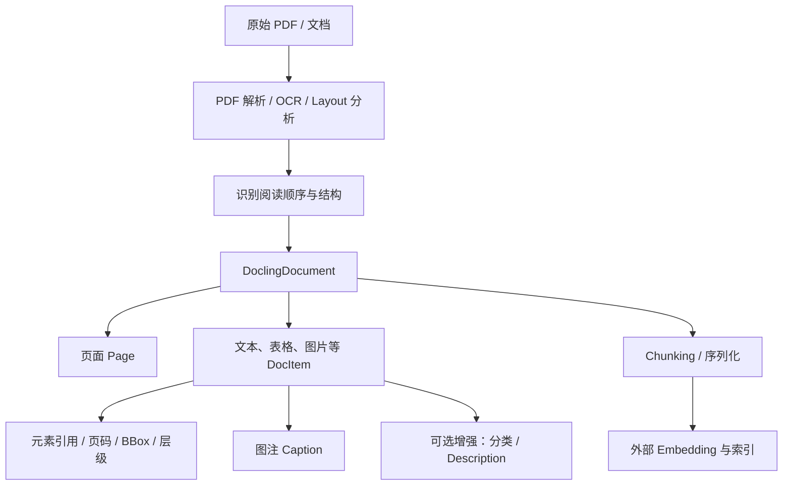
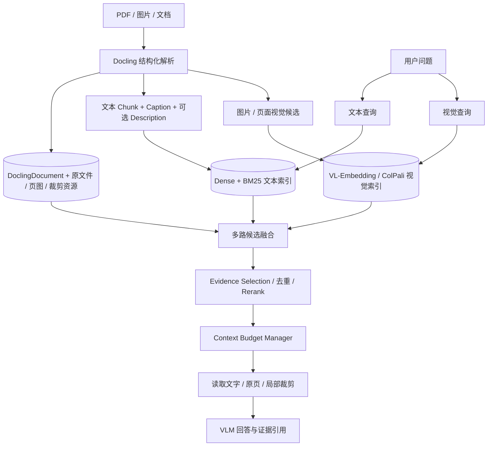

# Docling 与多模态 RAG：从结构化文档到视觉证据选择

> [!abstract] 核心结论
> **Docling 的核心价值不是“自动解决多模态检索”，而是把 PDF 等非结构化文档转换为结构化、可定位、可追溯的 `DoclingDocument`。**
>
> 向量检索先找到相关内容（通常是文本 Chunk），再借助结构化文档中的页码、坐标、图片、图注、布局等信息回到原始视觉证据。至于**哪些图片值得召回、最终带几张、何时读整页或局部裁剪**，仍然需要独立的检索与证据选择策略。

## 1. 讨论背景：图文混合 RAG 真正难在哪里？

之前做图文混合 RAG 时，遇到的关键问题不是简单地“图片不能 Embedding”，而是：

1. **文本召回与图片召回的关联并不等于答案相关性。** 命中某段文本，可能关联同页多张图片，但只有其中一张有用，甚至一张都不需要。
2. **无法直接确定应该带回多少张图片。** 固定 Top-K 是候选上限，而非对实际证据需求的判断。一次问题可能需要 0、1、2 或更多张图片。
3. **仅靠文字描述有信息损失。** Caption 或 VLM Description 通常无法完整表达图表细节、结构空间关系、小字标注和复杂连接。
4. **最终上下文有成本约束。** 整页图可能包含有用信息，但视觉 Token、延迟与清晰度之间存在取舍。
5. **纯文本召回可能完全找不到视觉答案。** 如果关键信息只在图中，而图片描述不足，文本检索根本无法进入正确页面。

VL-Embedding、ColPali 一类方案改善了视觉召回，但并不会自动解决第 1、2、4 个问题。

**讨论中逐渐形成的观点：应明确分离 `Retrieval（召回候选）`、`Evidence Selection（选择证据）` 和 `Context Assembly（装配上下文）`。**

---

## 2. Docling 究竟负责哪部分？

[Docling](https://github.com/docling-project/docling) 是开源文档解析工具，其重要能力包括：

- 从 PDF 等格式中提取文本与版面布局；对扫描件可结合 OCR；
- 识别标题、段落、图片、表格、图注等文档元素；
- 尽可能恢复阅读顺序、章节结构、表格结构；
- 为元素记录 `self_ref`、来源页码、`bbox` 等信息；
- 可选地做图片分类、图片描述、公式等增强处理；
- 将结果组织为 `DoclingDocument`，供后续导出、切块和检索使用。

它**不是**一个自动包含“视觉 Embedding → 多路召回 → Rerank → 动态图片选择 → VLM 回答”的端到端多模态搜索引擎。

需要区分三个层次：

| 层次 | 职责 | 是否为 Docling 核心能力 |
|---|---|---|
| 文档解析与结构化 | PDF → 页面、文本、图片、表格、坐标、关系 | 是 |
| Chunking 与上下文序列化 | 按文档结构生成可索引片段，保留出处 | 是，提供组件 |
| 索引/召回/证据筛选/回答 | Embedding、向量库、融合、图片选择与上下文预算 | 官方有集成和示例，但完整策略需自行搭建 |

> [!important] 两个常见误解
> - **不是一页一个 `DoclingDocument`。** 一般一个输入文件解析为一个 `DoclingDocument`；其中包含多个 `pages` 以及属于这些页面的文档元素。
> - **不是先 Embedding 直接找到整个 `DoclingDocument`。** 典型 RAG 流程索引并召回文本 Chunk，再凭 Chunk 的文档 ID、元素引用和来源信息，加载对应的结构化文档与页面。

---

## 3. 文档解析阶段：为什么 `DoclingDocument` 很关键？



### 3.1 文档级、页级、元素级三层信息

可以建立下面这个心智模型：

```text
DoclingDocument（整份维修手册）
├── pages
│   ├── page 1：页面尺寸、可选的渲染图像
│   ├── page 2：页面尺寸、可选的渲染图像
│   └── page N：...
├── texts / tables / pictures / ...
│   ├── TextItem       -> self_ref + prov(page_no, bbox) + text
│   ├── TableItem      -> self_ref + prov + 表格结构
│   └── PictureItem    -> self_ref + prov + captions + 可选 meta / image
└── 文档树、节点关系、阅读顺序等
```

- `self_ref`：文档元素的稳定引用路径（例如 `#/pictures/3`），**仅在对应文档范围内解释**；
- `prov`：Provenance，来源定位信息，通常包含 `page_no`、`bbox`，可能还有字符范围；
- `captions`：引用原文中的图注元素；
- `meta`：可选的结构化增强信息，例如图片类别和模型描述；
- `image`：图片数据的引用或存储表示；具体是否实际保留像素，取决于解析设置与持久化方式。

下面是**概念示例**，不代表真实文档输出或所有版本的精确序列化字段：

```json
{
  "self_ref": "#/pictures/3",
  "label": "picture",
  "prov": [{
    "page_no": 12,
    "bbox": {"l": 100, "t": 170, "r": 500, "b": 440}
  }],
  "captions": [{"cref": "#/texts/36"}],
  "meta": {
    "classification": "示意图（概念字段）",
    "description": "显示冷却系统的进风口、风扇和空气流向（示例）"
  }
}
```

实际写生产代码时应以当前 `docling-core` 的模型定义为准，不能直接以这份示例 JSON 作为 API 契约。

### 3.2 图片信息并不只是图片像素

| 信息 | 来源 | 有什么用 |
|---|---|---|
| 图片本身 / 裁剪图 | 文档解析与页面渲染 | 在最终推理时提供视觉证据 |
| Caption | 文档作者提供的图注 | 提供原始、相对可信的语义标签 |
| Description | 可选 VLM 生成 | 补全可供文本 Embedding/BM25 命中的视觉语义 |
| Classification | 可选图像分类模型 | 区分示意图、流程图、照片、图表等类型 |
| Page + BBox | 布局分析及来源记录 | 精确回到原页，或裁剪局部区域 |
| 章节/阅读顺序/邻接元素 | 文档结构恢复 | 确定图片上下文与关联文字 |

**Caption ≠ Description**。前者来自原文，后者由模型推断，可能遗漏细节或产生错误，不能无条件视为权威事实。

Docling 的 `PdfPipelineOptions` 可配置 `do_picture_classification`、`do_picture_description`、`generate_page_images`、`generate_picture_images` 等开关。可选增强与图像保留需要考虑模型成本、存储开销和运行版本。[官方 Pipeline Options](https://docling-project.github.io/docling/reference/pipeline_options/)

### 3.3 “有了页码就能找到原页”，但有前提

这个理解方向没问题，不过实际工程要**显式保存**以下至少一种可回溯资源：

- 原始 PDF/文档：在线按页重新渲染；
- 已渲染的页面图片：快速供 VLM 看整页；
- 局部裁剪图片及其索引；
- `DoclingDocument` 的可重新加载版本及图像资源引用。

如果只把文本 Chunk 扔进向量库、丢弃原始文档与图像资源，`page_no` 和 `bbox` 本身不会神奇地生成图片。

**注意**：不同解析后端、序列化方式与图片保留选项会影响 `image` 是否可用；外部引用也要维护路径/对象存储键。对 PDF 页面的裁剪，还要避免页面坐标系与渲染图片像素坐标系不一致，优先使用 Docling 提供的 `get_image()` 等接口。

---

## 4. Docling 官方 RAG 示例究竟怎么召回？

### 4.1 Visual Grounding：文本召回，再定位到原页

Docling 官方的 [Visual Grounding 示例](https://docling-project.github.io/docling/_generated/examples/visual_grounding/) 采用了：

1. Docling 将文档解析并 Chunking；
2. 用 Sentence Transformers 为**文本 Chunk**生成 Embedding；
3. 把 Chunk 和元数据存入 Milvus；
4. 查询时做文本向量 Top-K；
5. 利用被命中 Chunk 的文档信息、元素引用、`page_no` 和 `bbox`；
6. 定位到原始 PDF 页面，并高亮被命中证据的位置。


**重要区别：这个例子的 Visual Grounding 是“检索结果可视化定位与溯源”，并不等价于“图片经过 VL-Embedding 后被跨模态检索”。**

### 4.2 官方还有普通文本混合检索示例

[Retrieval with Qdrant](https://docling-project.github.io/docling/_generated/examples/retrieval_qdrant/) 展示了：

- `HybridChunker` 生成文本 Chunk；
- Dense Embedding + BM25 Sparse 向量；
- Qdrant 查询，并使用 RRF 融合（在示例配置下）。

这能提升文本检索的召回方式多样性，但依旧不是自动完成的图片检索与图片数量决策。

### 4.3 Chunk 到文档的关联怎么设计？

最少保留如下关系：

```text
vector_record_id
   -> chunk_id
   -> document_id / source_hash
   -> doc_item_refs[]
   -> 每个 DocItem 的 page_no + bbox
   -> 页面/图像存储资源
```

一个 Chunk 可能引用多个文档元素、跨多个页面，不能武断地简化成 `chunk -> 唯一 page_no`。具体的 `meta.doc_items` 和其他字段，要以当前 Chunker 的输出为准。

---

## 5. 我们讨论后形成的推荐架构（非 Docling 原生完整实现）

> [!note] 思路
> **离线阶段尽可能保留文档真源和丰富元数据；在线阶段根据问题动态决定阅读文字、整页图片还是局部区域。**
>
> 视觉证据的最终选取，尽量延迟到真正了解用户问题之后。



### 5.1 Retrieval：尽量找到足够好的候选

建议至少两个互补路径：

- **文本路径**：原文、Caption、Description → Dense / BM25；
- **视觉路径**：图片或整页视觉 Embedding（如 VL-Embedding、ColPali 类方案）→ 视觉检索；
- **关系扩展**：命中 Chunk 后，通过文档结构补充附近图片、图注、章节或相邻页面。

注意：文本、BM25 和视觉模型的分数空间通常不同，不能随意直接加权求和。可以先按排名用 RRF 融合，再做候选级重排或分数校准。

### 5.2 Evidence Selection：最重要、也最容易被忽略的一层

这一步回答的问题不是“找到了什么”，而是：

- 哪些候选图片**确实对回答有信息增益**？
- 是否有多个候选其实只是同一张图片的不同切块或重复页面？
- 当前问题是需要精确的空间关系、图中小字，还是仅需原文解释？
- 是否应该带回 0 张图片？

可先程序化执行**去重、按父图聚合、过滤低质量/低置信候选、限制预算**，只将少量模糊情况交给 VLM 细排，降低弱模型的心智负担和额外延迟。

> **关键区别：召回候选图片 ≠ 将图片立即放进最终 Prompt。**

### 5.3 Context Assembly：按需构造给模型看的证据

对于同一条命中的结构化证据，可以分几种模式：

| 模式 | 何时用 | 代价与风险 |
|---|---|---|
| 仅文本/Caption/Description | 问题可直接由文字回答 | 视觉细节缺失 |
| 局部图片裁剪 | 查询特定设备部件、单张图或表格区域 | 可能丢失上下文 |
| 整页作为图片 | 需要跨图文的空间关系、复杂布局 | 视觉 Token 高，小字可能模糊 |
| 整页缩略图 + 按需二次裁剪 | 不确定哪个区域相关 | 多一次读取/交互 |

建议定义可配置的**视觉预算**，例如最大图片数、最大像素量或视觉 Token 预算；并允许 **0 张图**。具体阈值要通过评测确定，不应该假设“最多 4 张”必然正确。

### 5.4 最小而清晰的返回协议

在线检索工具可以返回**证据候选描述**，不要一开始就塞图片 Base64：

```json
{
  "candidate_id": "c_001",
  "document_id": "manual_v1",
  "item_refs": ["#/texts/35", "#/pictures/3"],
  "pages": [12],
  "text": "检查冷却风扇和进风口是否堵塞……",
  "visual_candidates": [
    {
      "image_id": "img_003",
      "page_no": 12,
      "bbox": [100, 170, 500, 440],
      "caption": "图3-1 冷却系统",
      "description": "进风口位于右侧……",
      "asset_ref": "object://manual_v1/page12/img003"
    }
  ]
}
```

这里的字段是**自行设计的 Evidence Candidate 协议示例，不是 Docling 官方 API**。`asset_ref` 也只是伪格式。

后续可以提供 `read_visual_evidence(candidate_id, mode=page|crop)` 之类的只读工具，让模型或上层程序在必要时调取原始视觉内容。

---

## 6. 示例：同一页面，面对不同问题带不同证据

假设维修手册第 12 页包含：

- 文本 A：“电机过热时，检查冷却系统进风口是否堵塞。”
- 图片 3：“冷却风道与进风口结构示意图。”
- 图片 4：“电机内部零件爆炸图。”

**问题 A：**“电机过热有哪些排查方法？”

- 命中文本 A；
- 正文能够回答；
- 最终可能只带回文本，不带图片。

**问题 B：**“进风口具体在哪里？”

- 文本 A 提供语义入口；
- 根据关联关系扩展图片 3 和图片 4；
- Evidence Selection 优先选择图片 3，必要时裁剪进风口区域；
- 不因位于同一页面就盲目把两张图全部带回。

**问题 C：**“图中的 X3 端子怎么接线？”

- 单纯文本 Embedding 可能没有找到正确页面；
- 应让视觉检索、表格/标注文字提取或针对端子名的关键词检索补充召回；
- 再返回高清局部图，避免整页缩小导致关键信息无法阅读。

---

## 7. 需要警惕的技术边界

1. **解析丰富不意味着检索一定准确。** 解析器保留了大量信息，但是否进入索引、按什么粒度索引，仍取决于我们的策略。
2. **Caption/Description 有损且可能出错。** 不应让模型推断的描述覆盖原文和原图；保留来源与可回查性。
3. **图片在文本 Chunk 中可能只是占位符。** 不能假设默认 Chunk 中一定包含原始像素或所有图片增强信息；需要显式检查序列化策略。
4. **结构关系不等于语义关系。** 同一页或相邻 Bounding Box 的图片，不一定与当前问答相关。
5. **一个 Chunk 不一定对应一页。** 要从其引用的元素逐项获取 Provenance。
6. **多 Tile 图像要按原图聚合。** 若把每个 Tile 当作独立图片计数，可能让一张图挤满 Top-K。
7. **“能裁剪”不代表“裁剪必然正确”。** 图表跨栏、合并表格、图片边界误检、坐标转换都可能影响视觉质量。
8. **保留完整页面有存储与性能代价。** 对海量文档可考虑保留原 PDF、低分辨率页图及按需高清渲染；不要机械存储所有尺寸版本。

---

## 8. 如果做实验，怎么验证方案优劣？

建议先用一批图文混合技术手册建立小型评测集，刻意覆盖：

- 只需要文本的问题；
- 必须看一张图片的问题；
- 需要多张图联合判断的问题；
- 依赖图中局部小字或复杂连线的问题；
- 文本与图片同页、但图片与问题无关的问题；
- 答案存在图片中，但文字描述不足的问题。

| 方案 | 设计 | 想验证什么 |
|---|---|---|
| A（基线） | 文本检索 → 带回所有关联图片 | 传统方案的冗余与漏检 |
| B | 文本检索 → 结构扩展 → 图片筛选 | Evidence Selection 带来多少改善 |
| C | 文本 + 视觉双路召回 → 融合 → 图片筛选 | 视觉索引是否补上纯图片信息 |
| D（按需读取） | C + 先低成本候选、必要时二次读原页/裁剪 | 准确率与延迟/成本的权衡 |

应同时观察：

- 文本/视觉证据 Recall@K；
- **最终图片 Precision、Recall**（包括应该返回 0 张图的情况）；
- 回答正确率与证据引用准确率；
- 视觉 Token 消耗、延迟（P50/P95）、模型调用成本；
- 文档解析错误对下游答案的影响。

最重要的消融实验：**移除图片 Description、移除视觉索引、移除 Evidence Selection**，看哪些模块真正有价值。

---

## 9. 可以从哪里读源码？

### 官方项目与模型

- [Docling 主仓库](https://github.com/docling-project/docling)
- [Docling Core（`DoclingDocument` 及相关类型）](https://github.com/docling-project/docling-core)
- [DoclingDocument 数据模型与 Provenance](https://docling-project.github.io/docling/reference/docling_document/)
- [Pipeline Options（图片生成、分类、描述）](https://docling-project.github.io/docling/reference/pipeline_options/)

### 具体工程示例

- [Visual Grounding：文本召回后回溯页面](https://docling-project.github.io/docling/_generated/examples/visual_grounding/)
- [Export Figures：导出页面、图片和表格裁剪](https://docling-project.github.io/docling/_generated/examples/export_figures/)
- [Retrieval with Qdrant：Dense + BM25 混合检索](https://docling-project.github.io/docling/_generated/examples/retrieval_qdrant/)
- [Docling Chunking 服务配置（图片引用与 `has_image`）](https://github.com/docling-project/docling-serve/blob/main/docs/usage.md)
- [Docling Core HierarchicalChunker 源码](https://github.com/docling-project/docling-core/blob/main/docling_core/transforms/chunker/hierarchical_chunker.py)

### 延伸项目

- [ColPali：以页面视觉表示实现文档检索](https://github.com/illuin-tech/colpali)
- [Qdrant：可用于多向量与混合检索](https://github.com/qdrant/qdrant)
- [Google GDC Enterprise Search 的文章（本次讨论起点）](https://cloud.google.com/blog/topics/hybrid-cloud/managed-rag-search-inside-the-sovereign-perimeter-gemini-on-gdc-enterprise-search)

---

## 10. 本次讨论沉淀下来的工程观点

1. **文档结构化真源与索引表示分离。** `DoclingDocument` 保存完整结构与出处；Chunk / Embedding 只是面向召回的派生视图，可以按需重建。
2. **语义检索定位内容，文档结构定位页面，页面布局定位视觉证据。** 这三步构成可追溯的视觉检索链路。
3. **延迟决定视觉证据的使用方式。** 离线阶段不必提前决定最终必须带哪些图片；在线阶段根据问题选择文本、原页或局部裁剪。
4. **图片召回候选不等于图片进入 Prompt。** 多一个 Evidence Selection 层，才能认真解决图片数量不确定和误带图片的问题。
5. **文本与视觉双路是互补，而不是彼此替代。** 文本索引召回语义明确的内容，视觉索引补充仅凭图像可发现的证据。
6. **先程序化处理可确定的事，再交给模型判断模糊的事。** 例如关联、去重、预算、分数融合由程序做；是否需要细读某个模糊图片，可让 VLM 做有限选择。

> [!tip] 最终一句话
> **Docling 解决的是“把文档里的东西保存为可理解、可定位、可关联的结构化真源”；完整的多模态 RAG 还需要解决“如何检索并选择真正值得让模型阅读的视觉证据”。**

## 11. 后续值得研究的问题

- Docling 解析后的图文关联质量如何量化？仅靠图注引用、阅读顺序和版面邻近是否足够？
- 不同类型的视觉内容（照片、流程图、统计图、复杂设备结构图）是否应该使用不同的视觉索引和 Rerank 策略？
- 图片描述是统一生成，还是针对文档类型（例如设备结构、故障排查）采用特定 Prompt 更有效？
- 如何设计低成本的图像必要性判断：阈值、可学习排序、VLM 细排，还是由 Agent 按需读取？
- 对于大批量长文档，原始页面、缩略图、裁剪图和 Embedding 应如何分层存储和缓存？

**笔记性质：**基于 2026-10-21 的讨论与公开资料整理。文中“建议架构”“Evidence Candidate 协议”“实验设计”属于工程推演，**不是 Docling 官方承诺或内置的完整实现**；具体 API 和默认配置请以所使用的 Docling 版本为准。
