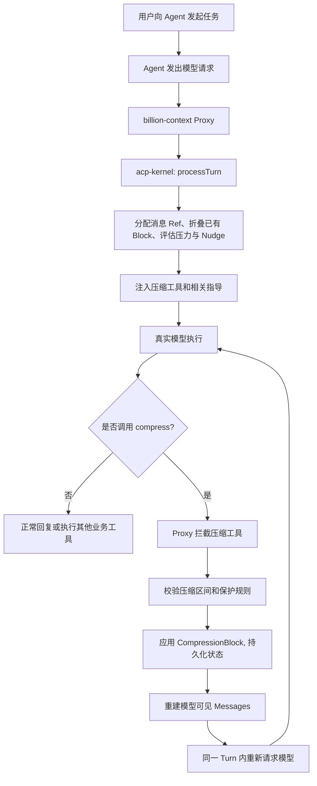
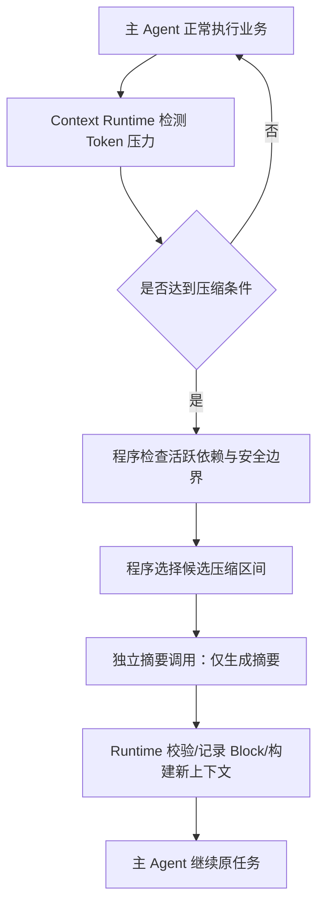

# billion-context 源码机制与弱模型 Harness 设计讨论

> [!abstract] 一句话总结
> **`billion-context` 的核心不是把模型上下文窗口扩展到十亿 Token，而是把上下文压缩变成 Agent 可以主动使用的工具能力：模型在正常工具循环中编写摘要，Runtime 负责校验范围、维护压缩状态、替换模型可见历史，并在需要时恢复原文。**
>
> **讨论后的工程结论：这种架构对强模型很有吸引力，但在弱模型场景下，让主 Agent 同时承担业务任务与上下文管理，会显著增加其决策、语义和协议负担。可以借鉴底层数据结构及 Prefix Cache 保护策略，不一定需要借鉴“由模型自主控制压缩”的交互方式。**

**项目地址：**[ranxianglei/billion-context](https://github.com/ranxianglei/billion-context)  
**压缩内核：**[ranxianglei/acp-kernel](https://github.com/ranxianglei/acp-kernel)  
**笔记时间：**2026-10-15  
**范围说明：**依据仓库公开 README、设计文档与部分核心源码，以及本次讨论整理。代码持续迭代，本文不是端到端部署或性能复测报告。以下将**项目机制**和**我们的分析/取舍**分开表达。

---

## 0. 为什么这个项目有意思？

传统 Agent 的上下文压缩通常是独立于主模型执行循环的流程：

```text
主 Agent 工作
  -> Runtime 检测 Token 压力
  -> 暂停/切换到 Compact 流程
  -> 摘要模型（可能是同一模型的独立请求）处理历史
  -> 替换历史上下文
  -> 主 Agent 继续执行
```

`billion-context` 则把 `compress` 当作一种上下文管理工具：

```text
主 Agent 工作
  -> 模型看到压缩工具及必要的 Nudge / 推荐区间
  -> 模型决定调用 compress，并直接给出摘要
  -> Runtime 校验、写入 CompressionBlock、重建可见历史
  -> 同一个用户 Turn 内再次请求模型，继续业务任务
```

**关键区别：**从用户视角看仍然是同一个 Turn；从模型调用视角看，是一次 Turn 中发生了多轮调用和一次特殊的工具执行。**不是**单次模型前向生成过程中“就地修改自己的 KV Cache”。

这使 Agent 有机会长期运行，而无需频繁进入宿主原生的全局 Compact 流程。但这是一种**条件性能力**，不是数学上保证“永不触顶”：模型可能不压缩、选错范围、摘要丢信息；Runtime 仍需保留紧急截断和失败保护。

## 1. 项目定位与总体架构

### 1.1 它是什么

`billion-context` 是位于 Agent 与模型 API 之间的**上下文压缩代理（Proxy）**，使用 `acp-kernel` 执行 Active Context Pruning / 分层增量压缩的核心逻辑；它也提供部分客户端的原生插件或启动器集成方式。基本思路是：

- **模型负责**：理解当前任务、决定是否使用相关工具、提供待压缩历史范围，并撰写高保真摘要。
- **Runtime / Kernel 负责**：消息标识、候选范围与保护规则、压缩状态、上下文折叠、摘要位置、恢复与预算保护。
- **宿主适配层负责**：协议转换、工具注入、模型 I/O、会话状态持久化、流式响应及内部再次请求。

作者所说的“十亿上下文”指**单会话长期累计处理的 Token 规模**，不等于让基础模型一次原生注意力计算读取十亿 Token。项目宣传的节省 Token、缓存命中率和长期运行数据是作者报告，应与我们自己环境下的实测区分。[项目 README](https://github.com/ranxianglei/billion-context/blob/master/README.zh-CN.md)

### 1.2 基础工具面

| 工具 | 功能 | 主模型新增负担 |
|---|---|---|
| `compress` | 把一段历史消息折叠成摘要 | 选择时机、区间、写摘要 |
| `decompress` | 按需找回被折叠内容 | 判断何时需要精确原文 |
| `search_context` | 在可见历史及压缩摘要里查找 | 判断查什么、如何利用结果 |
| `acp_status` | 查询上下文占用与可压缩情况 | 决定是否查询并解释结果 |

这是项目公开描述的基础上下文管理工具面；项目还在持续扩展其他可选能力，不能假设永远只有这四项。

### 1.3 端到端执行链路



> [!important] 边界要分清
> `acp-kernel` **不直接调用 LLM**。它接受模型或外部调用方已经写好的 `summary`，再负责确定性编排、校验与状态变化。真正发起模型请求的是 Proxy / Host。

---

## 2. 核心代码链路

### 2.1 `processTurn`：请求发送前的 Context Pipeline

重点入口：[kernel/src/compress.ts](https://github.com/ranxianglei/billion-context/blob/master/kernel/src/compress.ts)

公开实现的核心节点顺序可归纳为：

```text
reconcile-live-ids
  -> assign-refs
  -> sync-blocks
  -> prune
  -> ccr-store（可选）
  -> absorb-hide / crush / absorb-prompt（可选）
  -> filter
  -> hide-compress-calls
  -> recommend
  -> nudge-inject
  -> emergency-truncate
  -> render-refs
```

不是每个节点都无条件启用：部分属于可选特性或保护逻辑。

核心意义：**发送给模型的 Messages 是由原始历史和 CompressionState 计算出来的“可见视图”，而不是简单地从数据库删除旧消息。**

### 2.2 消息 Ref：让压缩范围可以精确寻址

内核管理稳定的历史引用，例如 `m00040`、`m00085`，并维护对宿主消息 ID 的映射。模型可以明确指定“压缩从某个 Ref 到某个 Ref”，而不是说“压缩刚才那一大段”。

压缩调用在逻辑上类似（**示意格式，非直接可复制的线协议**）：

```json
{
  "ranges": [
    {
      "startRef": "m00040",
      "endRef": "m00085",
      "topic": "装备维保数据结构探索",
      "summary": "已确认设备表与维保记录表的关联字段……后续查询应……"
    }
  ]
}
```

**最重要的一点：`summary` 是模型当场写出的文本，不是 Kernel 再去请求一个摘要模型生成的。**

### 2.3 `applyCompression`：校验并建立压缩块

调用到达后，Kernel 会处理范围寻址、未知或无效 Ref、近期消息保护、工具调用及结果的完整性、重叠与已消费块等问题。成功后更新状态、创建 Block、记录统计，并重设相应压缩增长基线。

典型的 `CompressionBlock` 数据结构包括：

```ts
// 结构化摘录，省略部分字段
interface CompressionBlock {
  blockId: string;
  tier: 1 | 2 | 3;
  topic?: string;
  summary: string;
  directMessageIds: string[];
  effectiveMessageIds: string[];
  directBlockIds: string[];
  active: boolean;
}
```

- `directMessageIds`：这次压缩**直接**覆盖哪些消息。
- `effectiveMessageIds`：考虑嵌套/被消费 Block 后，这份摘要最终代表哪些原始消息。
- `directBlockIds`：本轮压缩消费了哪些已有的压缩块。

这些字段既用于追踪原始范围，也用于处理多代折叠后的摘要放置位置。参见 [acp-kernel / DESIGN.md](https://github.com/ranxianglei/acp-kernel/blob/master/DESIGN.md)。

### 2.4 `prune`：压缩“模型可见历史”，不把摘要当原文真源

压缩前：

```text
System
User（早期目标）
Assistant / Tool 1 ... Tool 85
User（当前任务）
```

压缩后，模型看到的可能是：

```text
System
User（受保护的早期目标）
...
[Block b12 / 装备维保数据结构探索]
摘要：已确认关联字段、关键业务约束、未完成事项……
User（当前任务）
```

原始内容在宿主/会话历史等存储中仍需能够被定位，压缩状态维护折叠关系；恢复能力的实际上限取决于宿主是否仍保留可访问的原始内容与相关状态。**可恢复不代表摘要本身是无损压缩算法。**

阅读：[kernel/src/prune.ts](https://github.com/ranxianglei/billion-context/blob/master/kernel/src/prune.ts)

### 2.5 `Nudge`：鼓励压缩，不是必然自动压缩

Kernel 可以根据上下文占用、增长量、可压缩收益、近期消息保护等条件生成 Nudge，并给出候选区间。进入较高压力区间后，可以加强提示；到了危险阈值还会有程序级紧急保护。

但有两个层次：

1. **程序判定是否需要向模型提供压缩机会 / 压力信号**；
2. **模型是否实际调用工具，以及如何编写摘要**。

因此，“模型自主压缩”并不等于“系统完全无法用 Token 阈值驱动”。程序原本就在做压力检测和策略控制；可以进一步把主动决策面缩小。

### 2.6 多级压缩与按需恢复

```text
原始消息 A ─> Block b1（Tier 1） ─┐
原始消息 B ─> Block b2（Tier 1） ─┼─> Block b4（Tier 2） ─> ... Tier 3
原始消息 C ─> Block b3（Tier 1） ─┘
```

它不是每次从头重写全量历史，而是尽量增量归档；摘要本身随后也可能被消费并折叠成更高级摘要。`search_context` 用于定位线索，`decompress` 用于找回历史细节。基础搜索主要是词法/关键词路线，不是默认依赖向量库。

对长会话而言，这减少了“旧信息每次都被重新摘要一遍”所导致的重复信息损失。但 Tier 合并本身依旧会有语义损耗，而且检索、恢复也会带来 Token 与工具调用成本。

---

## 3. 为什么它重视 Prefix Cache？

### 3.1 压缩率不是唯一优化目标

假设一次上下文里有稳定前缀和不断增长的后缀：

```text
[固定 System + Tools][历史 A][历史 B][新增尾部]
```

**方案 A：全局重写历史。**

```text
[固定 System + Tools][全新总摘要][新增尾部]
```

如果摘要替换发生在靠前位置，后续内容的缓存前缀就可能失效。即使总 Token 变少，当次以及后续请求的 Prefill 代价仍可能很高。

**方案 B：局部折叠靠后的已消费区间。**

```text
[固定 System + Tools][保持不变的历史 A][局部摘要 B'][新增尾部]
```

这种改写更有机会复用前半段的 Prefix Cache。

需要强调：**局部压缩不是“零缓存损失”，只是尽量把首次发生字节变化的位置后移。** 实际命中还受提供商缓存粒度、TTL、请求结构、模型切换等影响。

### 3.2 源码里一个特别典型的工程细节

`prune.ts` 为摘要选择插入位置（anchor）时，优先使用 `directMessageIds`，而不是把新的多代摘要锚定到所有祖先内容的最早位置。否则高层摘要可能突然跑回很早的消息位置，把原本稳定的缓存前缀破坏掉。

这是直接围绕 **Prefix Cache 稳定性** 做出的数据结构/渲染设计。参考：[prune.ts / collectSummaryAnchors](https://github.com/ranxianglei/billion-context/blob/master/kernel/src/prune.ts)。

### 3.3 对本地部署的启发

在 Prefill 成本高、Prefix Cache 很重要的模型服务中，不能只比较摘要前后 Token 数；至少要同时衡量：

- 本次压缩新增了多少模型计算 / 工具循环；
- 改写发生在历史的哪个位置、会使多少缓存前缀失效；
- 未来多少次请求能够因缩短上下文而节省成本；
- 摘要后是否需要重新读工具结果或补查历史。

可以建立一个粗略的成本视角：

$$
C_{\mathrm{total}} \approx C_{\mathrm{compression}} + C_{\mathrm{cache\ miss}} + C_{\mathrm{future\ context}} + C_{\mathrm{recall}}
$$

这里的公式是**分析框架，不是项目源码里的实际优化目标函数**。

---

## 4. 我们真正讨论的问题：弱模型的“心智负担”

项目的机制让人觉得优雅：Agent 自己知道什么已经使用完毕，自己决定何时压缩、写好摘要，Runtime 只做状态变化。

**但在弱模型条件下，给 Agent 增加能力，不代表它一定能更好地完成任务。**

### 4.1 风险首先可能是工具和决策面过多

对原本只需要业务工具的 Agent，新增 `compress`、`decompress`、`search_context`、`acp_status`，不只是“多出四个工具”。它还引入持续存在的元决策：

```text
我要继续完成业务任务吗？
还是先查上下文占用？
是否需要压缩？压缩哪个区间？
哪些信息以后仍然有用？
压完之后需不需要恢复？
恢复了以后会不会再次触发压缩？
```

这些问题会与原本的业务查询、工具参数、结果分析和正式回答竞争模型的有限能力。

### 4.2 “心智负担”可拆成三部分

| 负担 | 典型要求 | 对弱模型的风险 |
|---|---|---|
| **决策负担** | 何时调用哪个工具、压缩哪段 | 工具误选、无效循环、主任务被打断 |
| **语义负担** | 判断重要依赖、正确摘要、理解召回内容 | 关键约束遗漏、摘要偏离任务 |
| **协议负担** | 指定 Ref、正确构造工具参数、输出特殊标记 | JSON/ID/占位符错误、格式执行失败 |

“模型心智负担”（*Model Cognitive Overhead*）在这里是**我们提出的工程分析概念**，不是一个已经在该项目论文中被正式定义、验证的指标。它也不等价于 Token 数、上下文长度或推理时延。

### 4.3 一个真实的例子：RAG / 业务查询结果的特殊占位符

此前尝试的设计：

```text
模型调用 RAG 或查询业务数据
  -> 返回检索/业务结果
  -> 要求模型在回答中特意写出特殊占位符
  -> 前端解析占位符并 link 到原始业务内容
```

目标本身合理：让最终回答里的引用能够跳转到真实数据对象。

但这样一来，模型除了要理解业务和给出正确答案，还要**识别关联关系、记住特定格式、生成正确 ID 或占位符、遵守位置规则**。实测在弱模型上表现较差。

这揭示了一个原则：

> **不该因为一个功能最终表现为“模型输出”，就默认让模型承担它全部的协议和状态管理责任。**

如果来源映射在工具执行阶段已经确定，可让工具/Runtime 保存结构化引用元数据，前端负责展示与跳转。模型只有在“某句话到底引用了哪个来源”不能靠确定性规则判断时，才承担必要的语义选择。这样不能保证所有引用任务都无需模型，但能减少无意义的格式负担。

### 4.4 信息丢失不应被当成自主压缩唯一的否定理由

讨论中一个重要观点：**普通 Compact 同样会丢信息**，因此不能简单地说“自主压缩可能丢依赖，所以绝对不行”。

不过，自主压缩在常规摘要损耗之外，还额外增加了**压缩时机选择**与**压缩区间选择**的不确定性：

```text
传统方式：程序定时机/范围 -> 模型生成摘要 -> 程序替换

自主方式：模型选时机 -> 模型选区间 -> 模型保留语义 -> 程序校验并替换
```

Kernel 的校验能够捕获非法范围、坏引用、某些保护区间冲突，但**无法从形式上保证摘要没有漏掉未来重要的业务信息**。

因此要评估的是：让模型拥有更多控制权所带来的收益，是否值得额外增加的任务失败风险。

---

## 5. 对受限 Harness 的工程取舍

### 5.1 最重要的判断

> [!tip] 核心设计原则
> **Harness 内部可以很复杂，但暴露给主模型的决策面应该尽可能小。**
>
> 系统功能复杂度不应直接转化成模型认知复杂度。能够由程序稳定完成的机械工作，应尽量留在 Runtime；模型只承担必须依赖语义理解的部分。

这不是说所有 Agent 都不应该有自主上下文管理工具。对高能力模型、长期 Coding Agent 或研究性系统，它可能是非常合理的方案。问题是**模型能力与业务场景是否匹配**。

### 5.2 哪些值得借鉴，哪些暂不采用

| 技术/策略 | 对受限环境的建议 | 理由 |
|---|---|---|
| 稳定 Message Ref | **值得借鉴** | 可精确寻址、回溯、保护依赖 |
| `CompressionBlock` 与状态图 | **值得借鉴** | 原始历史与模型视图区分、利于恢复 |
| `prune` 的稳定锚点策略 | **值得重点研究** | 减少 Prefix Cache 非必要失效 |
| 依赖/近期消息保护 | **值得借鉴** | 用 Runtime 规则降低破坏活跃任务的风险 |
| 按需历史检索与恢复 | **可选** | 好处明确，但要看工具暴露和恢复成本 |
| 由模型决定是否压缩 | **当前不优先** | 程序用 Token 压力即可进入相应状态 |
| 由模型任意选择压缩范围 | **当前不优先** | 增加决策面，且容易碰到活跃依赖 |
| 给主 Agent 暴露整套压缩工具 | **当前不采用** | 工具过多且会争夺有限的业务决策能力 |

### 5.3 一个替代路线：程序主导、模型只承担摘要生成



这条路线也可以复用 `billion-context` 的一些底层思想，但**不需要给主 Agent 额外暴露 Context 工具**。

要点：

1. **程序负责何时压缩**：Token 压力、增量增长、剩余窗口等可由确定性逻辑判断。
2. **程序尽量选择压缩范围**：优先选择完整且已结束的工具交互片段，保护当前 Run 正在依赖的内容。
3. **摘要模型只做语义任务**：接收明确范围和清晰的保留指令，避免附加复杂工具决策。
4. **Runtime 管理数据模型**：维护 Block、引用关系、可见上下文与恢复路径。
5. **保留边界兜底**：即使摘要或恢复失败，也不能把会话推到超过模型窗口的状态。

需要注意：这套方案并不自动继承项目的 Prefix Cache 优势。若压缩位置很靠前，独立摘要与历史改写仍可能导致缓存损失，必须实测。

### 5.4 可进一步研究：按条件切换不同压缩模式

我们之前讨论过两个技术方向：

- **缓存友好的局部压缩**：优先保持旧前缀不变，在较靠后的、安全完成的历史区间做折叠。
- **清理工具结果后再压缩**：先程序化减少无价值的工具输出，再让摘要模型压缩；Token 数可能更小，但可能改写更早的历史并导致 Prefill 增加。

可以把“活跃任务依赖是否结束”“预估缓存失效成本”“可清理的工具结果体积”“未来预期请求数”作为候选决策依据。

不过**这只是值得设计实验的策略空间，还不是已经被证明最优的动态切换算法**。特别是对依赖当前工具结果的 Run，不能为了追求压缩率把它提前有损清理。

---

## 6. 如何验证“多给工具可能反而降低任务完成率”

建议用**同一模型、同一业务任务集、尽量相同的上下文条件**做消融实验，而不是只比较压缩率。

| 实验组 | 暴露给主模型的能力 | 上下文治理方式 |
|---|---|---|
| A：Baseline | 原有业务工具 | 当前程序化 Compact |
| B：自主压缩 | 业务工具 + 4 个 Context 工具 | 模型触发 `compress` |
| C：程序主导 | 只暴露原有业务工具 | Runtime 选时机/范围，摘要模型生成内容 |
| D：混合策略 | 只暴露业务工具 | Runtime 在安全区间内动态选择局部压缩/工具清理 |

建议观察：

- **主任务完成率**：用户问题是否最终正确解决；
- **工具选择准确率**：业务工具是否被正确选中；
- **循环和恢复故障**：无效工具调用、重复压缩、错误恢复次数；
- **协议错误率**：参数格式、ID、引用占位符等错误；
- **摘要依赖保留率**：需要再次使用的关键事实是否还在，能否恢复；
- **上下文/缓存/时延**：有效 Token 占用、Prefix Cache 命中、TTFT、整体完成耗时；
- **额外开销**：摘要模型调用量、恢复与重复查询量。

“心智负担”可以用这些任务结果变化来**间接操作化衡量**，而不是假设它能被一个天然的单值直接测出。

---

## 7. 最后的讨论结论

本次讨论真正有价值的，不只是学会 `billion-context` 的压缩机制，而是更清楚地分辨：

**A. 模型擅长什么？** 语义理解、基于当前任务提炼信息、处理必须依赖语义的选择。  
**B. Runtime 擅长什么？** 计数、阈值、状态维护、引用映射、范围合法性、工具协议、流程控制和异常恢复。  
**C. 主 Agent 最应该保留什么能力？** 围绕**用户业务目标**作决策，而不是持续维护整个系统的内部机制。

一个表面上很优雅的模型自主控制方案，在强模型环境可能很合适；但在弱模型环境，可能表现为工具选错、任务中断、协议出错和循环增加。

最终值得记住的是：

> **好的弱模型 Harness，不是让模型学会做越来越多的事，而是通过更可靠的 Runtime 设计，让它用有限的能力完成更多真正重要的事。**

或者更工程化一点：

> **把确定性交给程序，把必要的语义交给模型；缩小主 Agent 的决策表面积，而不是单纯减少系统功能。**

---

## 8. 源码阅读顺序与参考资料

推荐按“入站处理 → Core → 状态应用 → Context 渲染 → 内部工具循环 → 恢复”顺序阅读：

1. [项目 README（中文）](https://github.com/ranxianglei/billion-context/blob/master/README.zh-CN.md)：定位、基础工具与代理使用方式。
2. [技术说明（中文）](https://github.com/ranxianglei/billion-context/blob/master/TECHNICAL-NOTES.zh-CN.md)：Proxy / Host 集成边界。
3. [src/server/prepare-anthropic.ts](https://github.com/ranxianglei/billion-context/blob/master/src/server/prepare-anthropic.ts)：请求入站、消息预处理与工具注入入口。
4. [kernel/src/compress.ts](https://github.com/ranxianglei/billion-context/blob/master/kernel/src/compress.ts)：`processTurn`、`applyCompression`、Pipeline 节点。
5. [kernel/src/prune.ts](https://github.com/ranxianglei/billion-context/blob/master/kernel/src/prune.ts)：如何折叠已覆盖消息、放置摘要锚点、保护缓存前缀与工具配对。
6. [src/loop/core.ts](https://github.com/ranxianglei/billion-context/blob/master/src/loop/core.ts)：`compress` 工具拦截、应用、重新向模型发起请求的循环。
7. [src/decompress-shared.ts](https://github.com/ranxianglei/billion-context/blob/master/src/decompress-shared.ts)：恢复和搜索历史的宿主侧逻辑。
8. [acp-kernel / DESIGN.md](https://github.com/ranxianglei/acp-kernel/blob/master/DESIGN.md)：核心数据结构、无 I/O 的内核边界与重要不变量。
9. [项目论文 / 预印本](https://github.com/ranxianglei/billion-context/tree/master/paper)：作者的性能主张、增量分层摘要动机、长会话数据与限制。

> [!warning] 使用时的注意事项
> - 当前仓库迭代速度快，本文记录的是 **2026-10-15 附近**的公开设计，后续应以对应 commit 的源码为准。
> - 文中的示意 `JSON`、架构图和部分规则描述用于解释机制，不保证能直接作为实际工具参数或生产实现。
> - **没有进行当前业务模型上的 A/B 实验**；“自主压缩不适合当前弱模型环境”是基于既有弱模型工程经验作出的风险判断，不是普遍的模型能力结论。
